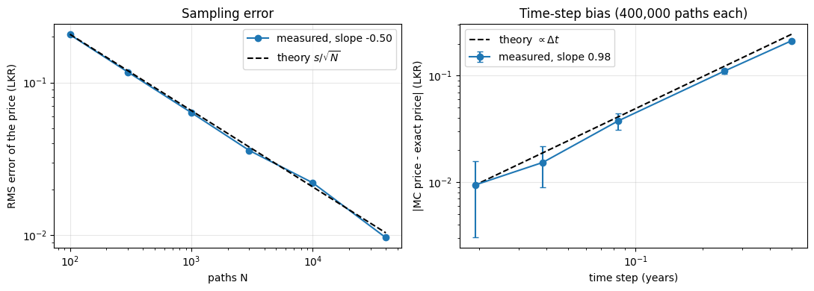

# Vasicek Bond Risk Simulator

A Monte Carlo simulator that prices a 5-year Sri Lankan Treasury bond and estimates how much value it could lose in a year, using the Vasicek interest-rate model fitted to real Central Bank of Sri Lanka data.

## Live demo

- **Web demo:** https://venujaranasinghe.github.io/vasicek-bond-risk-simulator/
- **Notebook:** [](https://colab.research.google.com/github/venujaranasinghe/vasicek-bond-risk-simulator/blob/main/notebook/vasicek_bond_risk.ipynb)
- **YouTube demo:** https://youtu.be/mJ5HGa-ItBs?si=RC9ZUBrZTaOOLWSJ

## Screenshot


*The interactive web demo running 50,000 simulated short-rate paths for the calm-period calibration (2024 to 2026), showing the 5-year bond price, one-year 95% Value-at-Risk and Expected Shortfall, and live agreement with the notebook reference result.*

## The problem

Treasury bonds are a core holding of Sri Lankan banks, pension funds and individual savers. A bond pays fixed amounts on fixed dates, so when interest rates rise, the bond becomes worth less. Sri Lankan rates have moved violently: the 91-day Treasury bill yield went from under 5% in 2020 to above 33% in late 2022, and returned to single digits in February 2024.

This project asks one question:

> **What is the fair value of a 5-year Sri Lankan Treasury bond under current rate conditions, and how much value could a holder lose over one year at 95% confidence if rates rise?**

The scope is deliberately narrow: one bond, one source of risk (the short-term interest rate) and one core model (with a Cox–Ingersoll–Ross extension for comparison). Credit risk, liquidity and taxes are left out.

## Quick start

**Run the notebook in the cloud.** Click the *Open in Colab* badge above, then choose **Runtime → Run all**. It needs no setup and finishes in about a minute.

**Run the notebook locally.**

```bash
git clone https://github.com/venujaranasinghe/vasicek-bond-risk-simulator.git
cd vasicek-bond-risk-simulator
pip install -r requirements.txt
jupyter notebook notebook/vasicek_bond_risk.ipynb
```

**Open the web demo.** Visit the [live demo](https://venujaranasinghe.github.io/vasicek-bond-risk-simulator/), or open `docs/index.html` directly in Chrome, Edge or Firefox (keep `style.css` and `script.js` in the same folder).

## User guide

The web demo lets you switch between two fitted calibrations (*Calm period* and *Full history incl. 2022 crisis*), adjust all model and bond parameters via sliders or by dragging directly on the main chart, start/pause/reset the simulation, and inspect live convergence, one-year loss distribution, and discount factors. Full instructions and a labelled walkthrough are in [USER_GUIDE.md](USER_GUIDE.md).

## Model and maths

The short-term interest rate $r_t$ follows the Vasicek stochastic differential equation:

$$dr_t = \kappa(\theta - r_t)\,dt + \sigma\,dW_t$$

- $\theta$ is the long-run level the rate is pulled towards.
- $\kappa$ is how fast it is pulled back.
- $\sigma$ is the size of the random shocks.

**Calibration.** Over a fixed weekly step $\Delta = 1/52$, the model is an exact first-order autoregression between this week's rate and next week's. Fitting that line by ordinary least squares to Central Bank of Sri Lanka 91-day Treasury bill yields gives $\kappa$, $\theta$ and $\sigma$.

**Simulation.** Paths are advanced with the Euler–Maruyama scheme, with $Z_n \sim \mathcal{N}(0,1)$:

$$r_{n+1} = r_n + \kappa(\theta - r_n)\,\Delta t + \sigma\sqrt{\Delta t}\,Z_n$$

**Pricing.** A bond's value is the average, over all simulated paths, of its cash flows discounted along each path using the trapezoidal rule:

$$P(0,T) = \mathbb{E}\left[\exp\left(-\int_0^T r_s\,ds\right)\right]$$

**Risk.** The bond is revalued one year ahead in every scenario. Value-at-Risk ($\mathrm{VaR}_{0.95}$) is the loss exceeded in only 5% of scenarios, and Expected Shortfall ($\mathrm{ES}_{0.95}$) is the average loss within that worst 5%.

**Extension.** The notebook also implements, calibrates and verifies the Cox–Ingersoll–Ross (CIR) square-root model using the full-truncation Euler scheme so rates remain strictly positive.

Full derivations, numerical schemes, stability conditions and exact reference formulas are in [THEORY.md](THEORY.md).

## Verification

All 18 automated `assert` checks pass in the notebook:

1. **Exact Vasicek zero-coupon price:** fine step ($\Delta t = 1/364$) matches closed form within 3 SE (63.8215 vs 63.8277); weekly step matches within 0.05 LKR (difference +0.0151).
2. **Rate moments:** simulated mean and variance at 1 and 5 years match the exact Ornstein–Uhlenbeck formulas (variance errors +0.46% and +0.52%).
3. **Deterministic limit ($\sigma = 0$):** matches the exact exponential ODE solution to within $4.0\times 10^{-5}$ and halves error when $\Delta t$ halves (ratio 2.006).
4. **Parameter recovery:** recovers known $(\kappa, \theta, \sigma)$ from synthetic paths within tolerance (+4.6%, −0.4%, +0.2%).
5. **Exact VaR and ES:** simulated one-year risk measures match closed-form Vasicek VaR and ES within 0.05 LKR (differences −0.025 and −0.029).
6. **Measured error scaling:** sampling error falls with log–log slope −0.503 (theory −0.5) and weak time-step bias scales with slope 0.981 (theory 1.0).
7. **CIR extension:** Monte Carlo price matches the exact CIR closed-form price (63.6436 vs 63.6359, within 3 SE; weekly step difference +0.0089).



*Log–log convergence checks confirming $O(N^{-1/2})$ Monte Carlo sampling error (left) and $O(\Delta t)$ weak discretisation bias (right). Additional verification and result plots are stored in `figures/`.*

## Concepts applied

This project applies Monte Carlo integration with confidence intervals based on the law of large numbers and the central limit theorem; input modelling, by fitting stochastic processes to observed time-series data, together with Gaussian random variate generation; and numerical solution of differential equations, using the Euler–Maruyama scheme (Euler's method extended to a stochastic differential equation) with its stability condition and weak order of accuracy. The simulator is verified against closed-form Vasicek and CIR bond prices, limiting-case ODE solutions, synthetic parameter recovery and measured error-scaling curves.

## Results, limitations and future work

**Baseline results** (seed 42, 10 replications of 100,000 paths, weekly time step, data to 9 July 2026):

| Quantity | Value |
|---|---|
| Calibration window | 15 February 2024 to 9 July 2026 (126 weeks) |
| Speed of mean reversion $\kappa$ | 0.766 per year (half-life about 11 months) |
| Long-run rate $\theta$ | 8.62% |
| Volatility $\sigma$ | 0.0141 |
| 5-year zero-coupon bond price | 63.841 ± 0.006 LKR per 100 face |
| 5-year 10% coupon bond price | 103.023 ± 0.008 LKR per 100 face |
| Model yield to maturity | 9.23% |
| One-year 95% VaR (vs today's value) | −8.22 ± 0.02 LKR (a gain) |
| One-year 95% ES (vs today's value) | −7.73 ± 0.02 LKR (a gain) |
| One-year 95% VaR (vs expected value) | 1.96 ± 0.01 LKR |

**Calibration-window and model comparison** (5 replications, 95% intervals):

| Scenario / Model | Price (LKR) | YTM | 95% VaR (LKR) | 95% ES (LKR) | P(loss) |
|---|---|---|---|---|---|
| Vasicek — Calm period (Feb 2024–Jul 2026) | 103.03 ± 0.02 | 9.23% | −8.22 ± 0.02 | −7.73 ± 0.03 | 0.0% |
| Vasicek — From Jan 2024 (Jan 2024–Jul 2026) | 106.11 ± 0.00 | 8.47% | −9.09 ± 0.01 | −9.03 ± 0.01 | 0.0% |
| Vasicek — Full history incl. crisis (2020–2026) | 95.13 ± 0.10 | 11.30% | 5.76 ± 0.09 | 9.12 ± 0.13 | 16.4% |
| CIR — Calm period (Feb 2024–Jul 2026) | 102.77 ± 0.02 | 9.29% | −7.84 ± 0.02 | −7.20 ± 0.03 | 0.0% |

Under the calm-period calibration, the bond's coupon income over one year outweighs the price drop from an adverse rate move, so the holder does not lose even in the worst 5% of scenarios. When the 2022–2023 crisis is included, volatility more than triples and the same bond faces a 95% VaR loss of 5.76 LKR (ES 9.12 LKR). Switching from Vasicek to CIR changes the calm-period price by only 0.26 LKR — far less than the choice of calibration window. Across 18 real 5-year Treasury bond auctions since February 2024, observed auction yields exceed the model par yield by 2.15 ± 0.56 percentage points on average, reflecting the omitted term and risk premium.

**Limitations.**

- The 91-day Treasury bill yield stands in for the instantaneous short rate.
- Parameters are constant over the bond's life, so the model cannot switch dynamically between calm and crisis regimes.
- Weekly rate changes in the data are not Gaussian: yields stay flat for stretches and then jump.
- The market price of interest-rate risk is set to zero, so model yields sit below observed 5-year auction yields.
- The Vasicek model allows negative rates when volatility is high (addressed by the CIR extension).
- Default risk, liquidity and taxes are ignored.

**Future work.** Fitting a market price of risk to observed bond auction yields, adding regime-switching or jump-diffusion dynamics, and extending to a multi-factor yield-curve model.

## Key references

- O. Vasicek, "An equilibrium characterization of the term structure," *J. Financ. Econ.*, vol. 5, no. 2, pp. 177–188, 1977, doi: 10.1016/0304-405X(77)90016-2.
- J. C. Cox, J. E. Ingersoll and S. A. Ross, "A theory of the term structure of interest rates," *Econometrica*, vol. 53, no. 2, pp. 385–407, 1985, doi: 10.2307/1911242.
- P. Glasserman, *Monte Carlo Methods in Financial Engineering*. Springer, 2003, doi: 10.1007/978-0-387-21617-1.
- P. P. Boyle, "Options: A Monte Carlo approach," *J. Financ. Econ.*, vol. 4, no. 3, pp. 323–338, 1977, doi: 10.1016/0304-405X(77)90005-8.

The complete reference list with DOIs and URLs is in [REFERENCES.md](REFERENCES.md).

## AI assistance

AI assistants were used to help write code, prepare the dataset and draft documentation. All code was run and checked by the author, and all results are verified numerically in the notebook.

## Licence and data credits

Code is released under the [MIT Licence](LICENSE).

Yield data: Central Bank of Sri Lanka, Data Library, "Rates on Government Securities". Data © Central Bank of Sri Lanka, used with attribution. See [data/README.md](data/README.md) for details.
