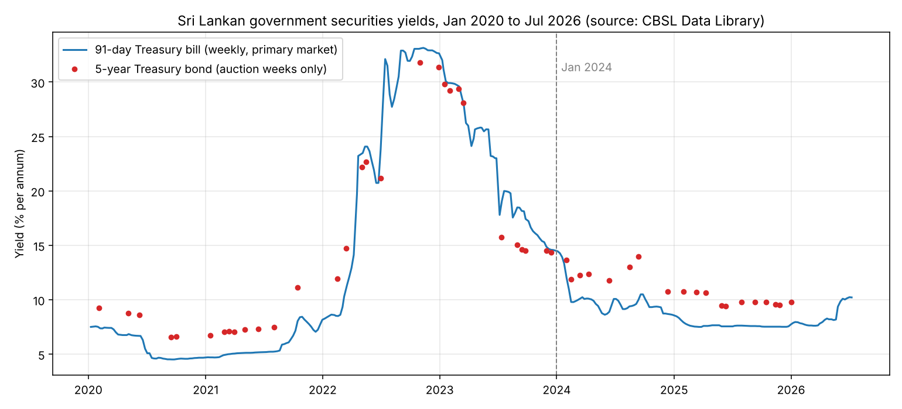

# Vasicek Bond Risk Simulator

A Monte Carlo simulator that prices a 5-year Sri Lankan Treasury bond and estimates how much value it could lose in a year, using the Vasicek interest-rate model fitted to real Central Bank of Sri Lanka data.

## Live demo

- **Web demo:** https://venujaranasinghe.github.io/vasicek-bond-risk-simulator/
- **Notebook:** [](https://colab.research.google.com/github/venujaranasinghe/vasicek-bond-risk-simulator/blob/main/notebook/vasicek_bond_risk.ipynb)

## Screenshot



*The 91-day Treasury bill yield (line) and 5-year Treasury bond auction yields (dots), January 2020 to July 2026. A screenshot of the web demo will replace this figure when the demo is complete.*

## The problem

Treasury bonds are a core holding of Sri Lankan banks, pension funds and individual savers. A bond pays fixed amounts on fixed dates, so when interest rates rise, the bond becomes worth less. Sri Lankan rates have moved violently: the 91-day Treasury bill yield went from under 5% in 2020 to above 33% in late 2022, and returned to single digits in February 2024.

This project asks one question:

> **What is the fair value of a 5-year Sri Lankan Treasury bond under current rate conditions, and how much value could a holder lose over one year at 95% confidence if rates rise?**

The scope is deliberately narrow: one bond, one source of risk (the short-term interest rate) and one model. Credit risk, liquidity and taxes are left out.

## What the project builds

| Part | What it is | Status |
|---|---|---|
| Dataset | Weekly government-securities yields, 2020 to 2026, from the Central Bank of Sri Lanka | Done |
| Calibration | Fits the three Vasicek parameters to 91-day Treasury bill yields | Done |
| Rate simulator | Euler–Maruyama simulation of thousands of possible future rate paths | Done |
| Bond pricer | Monte Carlo price of a zero-coupon and a coupon-paying 5-year bond, with confidence intervals | Done |
| Risk engine | One-year 95% Value-at-Risk and Expected Shortfall | Done |
| Verification | Checks against exact formulas, a limiting case and a parameter-recovery test | Planned |
| Convergence study | Measured error against number of paths and against time-step size | Planned |
| Calibration-window and sensitivity study | Which inputs drive the price and the risk figures | Planned |
| Cox–Ingersoll–Ross extension | A second model that keeps rates positive, checked against its own exact formula | Planned |
| Validation against auctions | Model yields compared with real 5-year bond auction yields | Planned |
| Web demo | A single page that runs the simulation in the browser with adjustable parameters | Planned |

## Quick start

**Run the notebook in the cloud.** Click the *Open in Colab* badge, then choose **Runtime → Run all**. It needs no setup and finishes in under a minute.

**Run the notebook locally.**

```bash
git clone https://github.com/venujaranasinghe/vasicek-bond-risk-simulator.git
cd vasicek-bond-risk-simulator
pip install -r requirements.txt
jupyter notebook notebook/vasicek_bond_risk.ipynb
```

**Open the web demo.** Visit the live demo link, or open `docs/index.html` in a current browser. *(Available once the demo is complete.)*

## User guide

The web demo lets you change the model parameters, start, pause and reset the simulation, watch the rate paths form, and read off the bond price with its confidence interval. Full instructions with screenshots will be in [USER_GUIDE.md](USER_GUIDE.md).

## Model and maths

The short-term interest rate $r_t$ follows the Vasicek model:

$$dr_t = \kappa(\theta - r_t)\,dt + \sigma\,dW_t$$

- $\theta$ is the long-run level the rate is pulled towards.
- $\kappa$ is how fast it is pulled back.
- $\sigma$ is the size of the random shocks.

**Calibration.** Over a fixed step the model is exactly a straight-line relationship between this week's rate and next week's. Fitting that line by least squares to weekly data gives $\kappa$, $\theta$ and $\sigma$.

**Simulation.** Paths are advanced with the Euler–Maruyama scheme, with $Z_n$ a standard normal random number:

$$r_{n+1} = r_n + \kappa(\theta - r_n)\,\Delta t + \sigma\sqrt{\Delta t}\,Z_n$$

**Pricing.** A bond's value is the average, over all simulated paths, of its cash flows discounted along each path:

$$P(0,T) = \mathbb{E}\left[\exp\left(-\int_0^T r_s\,ds\right)\right]$$

**Risk.** The bond is revalued one year ahead in every scenario. Value-at-Risk is the loss exceeded in only 5% of scenarios, and Expected Shortfall is the average loss within that worst 5%.

Derivations, the numerical schemes and their accuracy will be in [THEORY.md](THEORY.md).

## Verification

Four checks are planned, each shown in the notebook as a pass/fail test:

1. The Monte Carlo zero-coupon bond price against the exact Vasicek bond-price formula.
2. The simulated mean and variance of the rate against the exact formulas.
3. The limiting case $\sigma = 0$, where the rate must follow a smooth exponential curve.
4. Recovery of known parameters from synthetic data produced by the simulator itself.

A verification figure will be added here when the checks are complete.

## Concepts applied

This project applies Monte Carlo integration with confidence intervals based on the law of large numbers and the central limit theorem; input modelling, by fitting a stochastic process to observed data, together with Gaussian random variate generation; and numerical solution of differential equations, using the Euler–Maruyama scheme (Euler's method extended to a stochastic differential equation) with its stability condition and order of accuracy. The simulator is to be verified against the closed-form Vasicek bond price.

## Results, limitations and future work

**Preliminary results** (seed 42, 10 replications of 100,000 paths, weekly time step, data to 9 July 2026):

| Quantity | Value |
|---|---|
| Calibration window | 15 February 2024 to 9 July 2026 (126 weeks) |
| Speed of mean reversion $\kappa$ | 0.766 per year (half-life about 11 months) |
| Long-run rate $\theta$ | 8.62% |
| Volatility $\sigma$ | 0.0141 |
| 5-year zero-coupon bond price | 63.84 ± 0.006 per 100 face |
| 5-year 10% coupon bond price | 103.02 ± 0.008 per 100 face |
| Model yield to maturity | 9.23% |
| One-year 95% VaR against today's value | −8.22 (a gain) |
| One-year 95% VaR against the expected value | 1.96 |

Under a calibration to the calm period since February 2024, the bond's income over one year is larger than the fall in price caused by an adverse rate move, so the holder does not lose even in the worst 5% of scenarios. These figures are provisional and will be updated when verification and the remaining studies are complete.

**Limitations.**

- The 91-day Treasury bill yield stands in for the instantaneous short rate.
- The parameters are constant, so the model cannot reproduce a regime change such as the 2022 crisis. The estimates change sharply if the calibration window includes crisis-period data.
- Weekly rate changes in the data are not bell-shaped: yields stay flat for long stretches and then jump.
- No extra return for bearing interest-rate risk is included, so model yields sit below observed 5-year auction yields.
- The Vasicek model allows negative rates.
- Default risk is ignored.

**Future work.** A risk premium fitted to bond auction yields, a regime-switching or jump model, and a full yield-curve model.

## Key references

- O. Vasicek, "An equilibrium characterization of the term structure," *J. Financ. Econ.*, vol. 5, no. 2, pp. 177–188, 1977, doi: 10.1016/0304-405X(77)90016-2.
- P. Glasserman, *Monte Carlo Methods in Financial Engineering*. Springer, 2003.
- P. P. Boyle, "Options: A Monte Carlo approach," *J. Financ. Econ.*, vol. 4, no. 3, pp. 323–338, 1977, doi: 10.1016/0304-405X(77)90005-8.

The full list will be in [REFERENCES.md](REFERENCES.md).

## AI assistance

AI assistants were used to help write code, prepare the dataset and draft documentation. All code was run and checked by the author, and results are verified numerically in the notebook.

## Licence and data credits

Code is released under the [MIT Licence](LICENSE).

Yield data: Central Bank of Sri Lanka, Data Library, "Rates on Government Securities". Data © Central Bank of Sri Lanka, used with attribution. See [data/README.md](data/README.md) for details.
