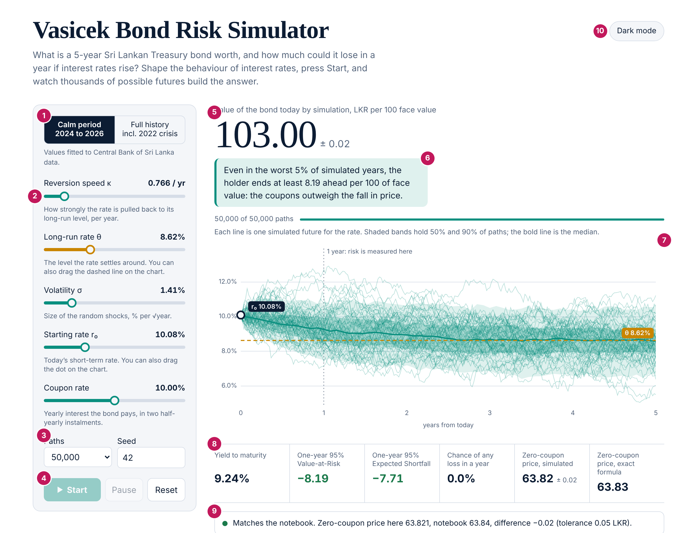

# User guide: the web demo

The demo runs the bond simulation in your browser. Nothing is installed and nothing is sent to a server.

## Opening it

- **Online:** https://venujaranasinghe.github.io/vasicek-bond-risk-simulator/
- **Offline:** download the `docs/` folder and double-click `index.html`. Keep `style.css` and `script.js` in the same folder.

It works in a current version of Chrome, Edge or Firefox.

## The screen

| No. | Part | What it is for |
|---|---|---|
| 1 | Fitted values | Two ready-made sets of model values, each fitted to Central Bank of Sri Lanka data |
| 2 | Sliders | The model and bond settings (see the next table) |
| 3 | Paths and seed | How many futures to simulate, and the starting number for the random generator |
| 4 | Start, Pause, Reset | Run, freeze or clear the simulation |
| 5 | Headline value | The bond's value today, per 100 of face value, with its 95% confidence interval |
| 6 | Verdict | A plain-language reading of the one-year risk: green for a gain, maroon for a loss |
| 7 | Rate paths | Simulated futures of the short-term interest rate over the bond's five years |
| 8 | Key figures | Yield, Value-at-Risk, Expected Shortfall, chance of loss, and the zero-coupon price by simulation and by exact formula |
| 9 | Notebook check | Whether the simulated price agrees with the notebook's reference result |
| 10 | Dark mode | Switches between the white and the dark colour scheme |

Three smaller charts sit below the key figures: how the price estimate settles as paths are added, the spread of one-year outcomes, and what one rupee paid on each coupon date is worth today.

## What each setting does

| Setting | Meaning | What happens when you raise it |
|---|---|---|
| Reversion speed κ | How strongly the rate is pulled back to its long-run level | Paths bunch more tightly around θ; the risk figures shrink |
| Long-run rate θ | The level the rate settles around | Future payments are discounted more heavily; the bond is worth less |
| Volatility σ | Size of the random shocks | Paths fan out; Value-at-Risk and Expected Shortfall grow |
| Starting rate r₀ | Today's short-term rate | Early payments are discounted more heavily; the bond is worth less |
| Coupon rate | Yearly interest paid by the bond, in two instalments | The bond is worth more and earns more over the year |
| Paths | Number of simulated futures | The confidence interval narrows; the run takes longer |
| Seed | Starting number for the random generator | The same seed always gives the same result |

Before any simulation runs, the chart, the headline value, the yield and the Value-at-Risk already respond to the sliders, using exact formulas. Pressing **Start** then tests those values by simulation and adds everything a formula cannot show.

## Using it

1. Choose a set of fitted values, or move the sliders.
2. Press **Start**. Paths are added in batches of 250 and every figure updates as they arrive.
3. Press **Pause** to freeze the run. Press **Start** to continue.
4. Press **Reset** to clear the run. Changing any setting also clears it.

You can also work directly on the main chart:

- **Drag the dashed line** up or down to change the long-run rate θ.
- **Drag the dot at the left edge** to change the starting rate.
- **Hover** over any chart to read the values at that point.

Dragging needs a mouse or trackpad. On a touch screen, use the sliders.

## Try this

1. Choose **Calm period** and press **Start**. The bond is worth about 103, and the Value-at-Risk is about −8: even in a bad year the holder ends ahead, because the coupons outweigh the fall in price.
2. Choose **Full history incl. 2022 crisis** and press **Start**. The value falls to about 95, and the Value-at-Risk becomes a loss of about 6.

The bond is the same in both runs. Only the assumed behaviour of interest rates has changed, and that is the main finding of the project.

## Reading the outputs

- **Values and prices** are in LKR per 100 of face value.
- **± figures** are 95% confidence intervals. They measure simulation error only and narrow as paths are added.
- **Yield to maturity** is the single yearly rate, compounded half-yearly, that would give the same price.
- **One-year 95% Value-at-Risk** is the loss exceeded in only 5% of scenarios, measured against today's value and counting coupons received. A negative figure means a gain.
- **One-year 95% Expected Shortfall** is the average loss within that worst 5%.
- **Chance of any loss** is the share of scenarios in which the holder ends the year behind.
- **Zero-coupon price, exact formula** is the known closed-form answer. The simulated price beside it should be close.

## Agreement with the notebook

With the **Calm period** values and at least 50,000 paths, the simulated zero-coupon price must match the notebook's reference result of 63.84 within 0.05 LKR. The status line under the key figures turns green when it does.

The two will not be identical: the notebook and the demo use different random number generators, so they draw different paths.

## Limitations

- The three model settings stay constant for the whole five years, so the model cannot move between calm and crisis behaviour.
- Shocks are normally distributed, while real rates sometimes jump.
- No extra return for bearing interest-rate risk is included, so model values sit above market prices.
- The Vasicek model allows negative rates when volatility is high.
- The demo revalues the bond after one year with the exact Vasicek formula; the notebook uses a simulated grid. The two agree within 0.05 LKR.
- The demo covers the Vasicek model only. Calibration, verification, the sensitivity study and the CIR model are in the notebook.
- Default risk, taxes and trading costs are ignored. This is a teaching tool and not investment advice.

## If something looks wrong

| What you see | Likely cause |
|---|---|
| A page with no styling and no charts | `style.css` or `script.js` is not in the same folder as `index.html` |
| "Does not match the notebook" | The fitted values in `script.js` differ from the notebook's current output |
| Results change between runs | The seed, the number of paths or a slider was changed |